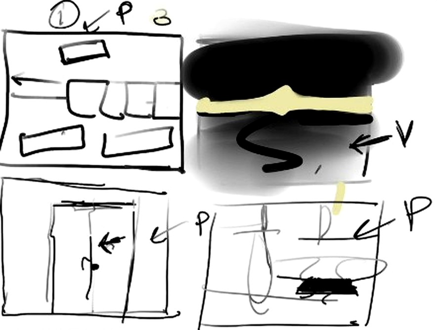
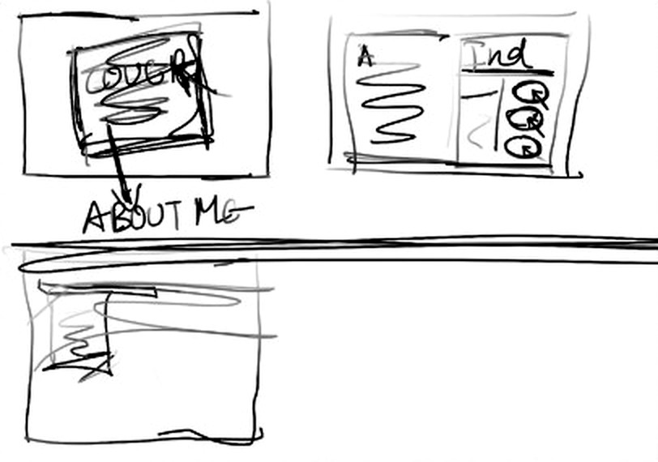

# Komal's portfolio: brief from the 15 Oct 2026 Meet

Source: `Meet – fgb-bukc-ytb - Google Chrome 2026-10-15 18-41-33.mp4` (32 min, Hindi/English).
Transcribed locally with Whisper large-v3 (translate mode reads best). The English transcript is in
[`docs/meet-transcript-en.txt`](docs/meet-transcript-en.txt). Timestamps below are mm:ss into the recording.

## Her two sketches (drawn live in Procreate)

| The intro storyboard (19:30–24:30) | The book plan (25:00–27:50) |
|---|---|
|  |  |

Labels on the storyboard: **P** = she will give photo references, **V** = video reference.

## What she asked for, in order

1. **"A lot of AI"** (07:15). The site opens on screens full of AI-made designs, like an Instagram feed
   (08:50). In the sketch the cards slide left, and the second panel has more and more of them (20:32).
   It progresses **as you scroll**, not as a forced video (19:54). Aayushman showed igloo.inc as the
   reference for scroll-scrubbed motion and she agreed ("oh yeah, this is fine", 11:52).
2. **A sudden glitch, then the old grey TV switching off** (07:21, 21:23). "The greyish TV that is not
   working properly, and then a line comes like a power cut." Then it blacks out. She wants this beat
   to take about **3 seconds** of scroll (21:52).
3. **A vintage almirah** (07:38, 22:13). "A proper vintage almirah", "a normal steel almirah". It is the
   third screen. You open it.
4. **Inside: 5-6 clothes lying or hanging, with one thing in the middle highlighted** (22:34-23:03).
   "They should know that they have to click this part."
5. **That thing is a scrapbook she made as a child** (08:00-08:22). "My aesthetic is very raw, very
   nostalgia-related." Clicking it brings the book up, cover first, with something written on it (25:14).
6. **Pages**: the first page has her name and a childhood photo (08:26). Then about her (not literally
   titled "About me", 26:06), then an **index**; pressing an index entry takes you to that project (26:46).
7. **Projects later** (27:04). She will arrange her projects and send them. Ideas for project pages:
   small GIF-like animations, a Polaroid with something on its other side (27:17).

Why: "the field I want to go into cares about storytelling" (16:31). She does not want AI to make her
work (14:01); the intro is the AI world she switches off.

## Things Aayushman raised that the build answers

- Recruiters revisit and should not sit through the intro every time (13:16). The intro is skippable,
  remembered per browser, and `#book` / `#index` deep-link straight into the scrapbook.

## Still needed from Komal

- A childhood photo for the first page, and the real handmade scrapbook cover if it still exists.
- Her own words for the about page and the intro captions (placeholders in `src/content/site.ts`).
- Projects: title, year, a short story, 4-8 images each, fabric/material notes.
- Contact: email, Instagram, any other handles.
- Reference photos/videos she promised for each storyboard panel (P/V labels).
